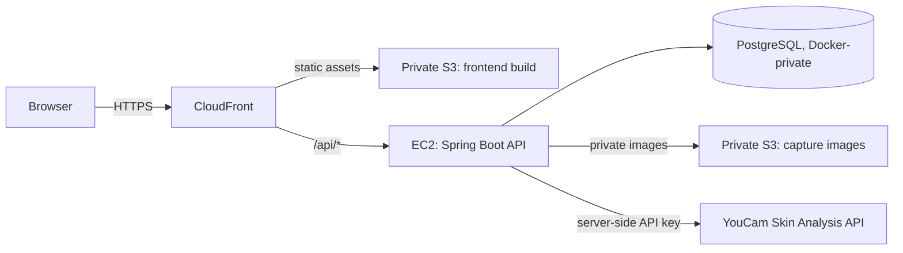

# SkinProof

SkinProof is a measured skincare-product experiment tracker. It reports cosmetic trends with explicit uncertainty — it is not medical advice, not a diagnostic tool, and does not make treatment or cure claims.

**Live demo:** [hosted demo endpoint omitted]

## What's implemented

- **Experiments**: create/list/archive a product trial with a target skin concern, start date, duration, and protocol notes, scoped to an isolated per-browser demo workspace.
- **Capture and analysis**: guided Camera Kit capture or photo upload fallback, a quality gate with explainable rejection flags, private S3 image storage behind short-lived access, and asynchronous YouCam SD skin-analysis with polling, retry, timeout, and image+concern de-duplication so a repeat upload never re-charges API units.
- **Verdict engine**: a provider-independent Java domain service that computes baseline vs. current means, a noise floor (paired-baseline or residual-based once enough captures exist), a verdict label (`IMPROVED` / `NO_DETECTABLE_CHANGE` / `WORSE` / `INCONCLUSIVE`), a confidence level, and a plain-language explanation. See [docs/measurement-verdict.md](docs/measurement-verdict.md) for the exact rules and boundaries.
- **Results UI**: a verdict panel with caveats and confound flags, a raw-score timeline with a shaded noise band, and a before/after comparison using the provider's own detection masks when available.
- **Ingredient check**: a deterministic, data-driven reference that matches a pasted ingredient list against a starter set of common actives/aliases, flags known irritation-risk combinations and sensitizing ingredients, and clearly marks unrecognized names instead of guessing. See [backend/src/main/resources/ingredient-rules.json](backend/src/main/resources/ingredient-rules.json) for the rule set.
- **Reproducible demo data**: an empty workspace can load three clearly labeled, synthetic example experiments (one improved, one confounded/inconclusive, one in-progress) so the UI has something to show without waiting eight real weeks. Simulated data is excluded from real verdict computation and is visibly labeled everywhere it appears; see [Simulated demo data](#simulated-demo-data) below.
- **Hosted on AWS**: the demo runs on CloudFront + S3 (frontend) and EC2 + PostgreSQL + Docker (API), with no dependency on a developer machine. See [docs/aws-demo.md](docs/aws-demo.md) for the infrastructure.

## Architecture

- **Frontend**: React + TypeScript (Vite), no router — a single-page experiment list with inline results/dialog views. Source in `frontend/src/`.
- **Backend**: Spring Boot (Java 21), organized by domain package under `backend/src/main/java/com/skinproof/api/`: `experiment`, `capture`, `analysis` (YouCam adapter), `verdict`, `ingredient`, `demo` (seed/reset). PostgreSQL via Flyway migrations in `backend/src/main/resources/db/migration`.
- **Provider isolation**: all YouCam-specific request/response mapping lives behind `YouCamSkinAnalysisService`; the verdict engine and the rest of the app never see provider-specific shapes directly.
- **Auth model**: a random UUID workspace ID is stored in browser `localStorage` and sent as `X-Demo-Workspace`. This separates demo data per browser profile; it is **not** authentication and must not be treated as one.

## API summary

All endpoints are served under `/api` behind CloudFront; see `/swagger-ui.html` and `/api-docs` on the running backend for the full generated reference.

| Endpoint | Purpose |
| --- | --- |
| `GET/POST /api/experiments`, `POST /api/experiments/{id}/archive` | Experiment CRUD, scoped by `X-Demo-Workspace`. |
| `POST /api/experiments/{id}/captures` | Upload a capture image with consent header, quality metadata, and target concerns; queues analysis. |
| `GET /api/experiments/{id}/captures` | List all captures for an experiment, oldest first. |
| `GET /api/captures/{id}`, `POST /api/captures/{id}/retry` | Check analysis status; retry a failed job. |
| `GET/POST /api/experiments/{id}/verdict` | Read the latest verdict (computed on demand) or recompute with confound flags. |
| `POST /api/ingredient-check` | Match a pasted ingredient list against the starter rule set; stateless, no workspace header required. |
| `POST /api/demo/seed` | Seed three labeled synthetic demo experiments into an **empty** workspace. |
| `DELETE /api/demo/data` | Permanently delete every experiment, capture, image, and verdict for this workspace. |
| `GET /api/health` | Health check used by the hosted demo and CI. |

## Privacy, consent, and retention

- Capturing an image requires an explicit, separate consent checkbox before any upload; the request is rejected server-side without it.
- Capture images are stored in a private S3 bucket (no public access, server-side encryption) and are only ever read by the backend to send to YouCam for analysis; they are not rendered back to the browser.
- The workspace ID is a browser-profile separator, not an account or login. Do not enter sensitive personal information or photos of other people.
- **Delete my demo data** (sidebar) permanently deletes every experiment, capture, private image, and verdict for the current browser's workspace. This cannot be undone and does not affect other browser profiles.
- SkinProof reports cosmetic trends only. It makes no medical, diagnostic, treatment, or cure claims; see the in-app disclaimer on every page.

## Simulated demo data

Because a real eight-week trial cannot complete before a short demo window, the three experiments created by **"load three simulated example experiments"** use synthetic, backdated capture data instead of live photos:

- Every synthetic capture is flagged `simulated` in the API response and is **excluded from real verdict computation** — the verdict engine (`VerdictEngine`) filters out `simulated` measurements by design, so simulated data can never silently inflate a real experiment's result.
- The synthetic verdicts shown for the demo experiments are pre-computed once, using the same verdict engine logic, and stored directly; they are never recomputed from real analysis callbacks.
- Demo experiment names are suffixed `(simulated demo)`, and the results view shows an explicit "uses simulated demo data" banner whenever any capture in that experiment is synthetic.
- Simulated captures have no corresponding image in S3 (no real photo was ever taken or uploaded) and never consume YouCam API units.

## Local development

- **Frontend**: `cd frontend && npm ci && npm run build` (or `npm run dev` for local iteration, `npm run lint` for oxlint).
- **Backend**: Java 21 and Gradle 8.12.1; `gradle -p backend test` runs the full JUnit suite (verdict rule boundaries, capture dedup/retry, ingredient-check matching, demo seed/reset, provider adapter error handling).
- CI installs both toolchains and runs these checks on every push; the hosted demo deploys continuously from the configured branch over GitHub Actions + Systems Manager (no manual server access required).

## Further reading

- [docs/api-notes.md](docs/api-notes.md) — verified YouCam API contract, score direction, unit costs, and live empirical run results.
- [docs/measurement-verdict.md](docs/measurement-verdict.md) — exact noise-floor, evidence, and verdict-label rules.
- [docs/aws-demo.md](docs/aws-demo.md) — Terraform modules, cost controls, and provisioning steps for the hosted environment.
